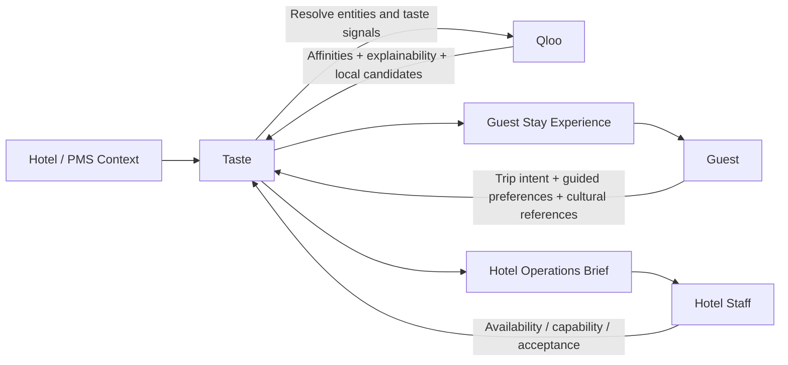
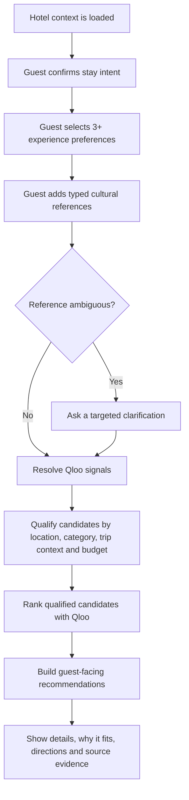
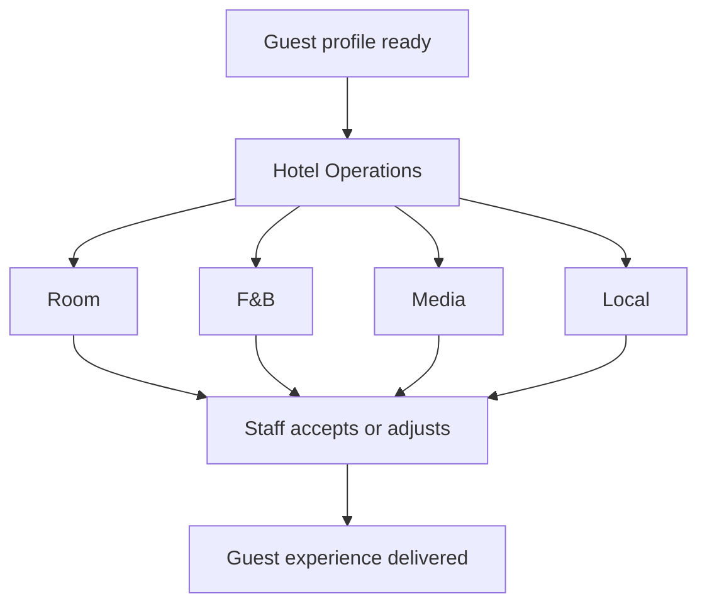

# Taste V2 Use Cases

Taste V2 separates the guest experience from hotel operations and makes the handoff between them explicit.

## Personas

### Guest
The guest wants useful, relevant ideas for this specific stay without needing to understand Qloo, hotel operations, or recommendation systems.

Primary goals:
- express trip intent quickly
- select experience categories without writing a long survey
- add a few recognizable cultural references
- receive recommendations that are actionable, geographically relevant, and easy to verify
- understand why a recommendation fits without seeing raw taxonomy

### Hotel staff
Hotel staff wants a concise preparation brief that changes what they do before and during the stay.

Primary goals:
- understand the trip context
- prepare the room appropriately
- know which F&B, media, and local recommendations to prioritize
- see the evidence behind Taste's recommendation when needed
- avoid exposing raw Qloo taxonomy as a guest identity claim

### Hotel systems
The hotel system provides context the property may already know so the guest is not asked to repeat it.

Examples:
- property and location
- stay dates
- party size
- adults and children
- trip purpose when known
- reservation or spend tier when appropriate
- room type and property capabilities in a future integration

## Use Case Diagram



## Guest Flow



## Staff Flow



## Product Rule

Taste should preserve the following separation:

```text
Hotel context + guest intent
        ↓
Resolved cultural signals
        ↓
Qualified candidate set
        ↓
Qloo ranking and explainability
        ↓
Taste interpretation
        ↓
Guest recommendation / hotel action
```

Qloo evidence informs the experience. It does not define the guest.

## Recommendation Contract

A local recommendation should not ship as only a name.

Guest-facing local recommendations should eventually include:
- name
- category
- short description
- why it fits
- location or neighborhood
- directions link
- travel distance or time when a reliable origin and coordinates are available
- price or spend signal when supported
- booking or official website link when available
- the Qloo signals that materially contributed to the recommendation

If any field is unavailable, Taste should omit it rather than invent it.

## Current V2 status

Implemented:
- isolated `taste-v2` branch
- trip-purpose context
- party size, adults, and children
- budget/spend comfort
- guided multi-select preference categories
- 1 to 5 cultural references
- typed cultural references for safer Qloo entity resolution
- separate guest and hotel-operations views
- guest-specific language instead of staff-oriented copy
- Qloo evidence remains inspectable

Next:
- tag resolution for genre/cuisine/activity concepts
- semantic validation of dining vs local candidates
- distance and travel-time support
- official website / booking / directions metadata
- dynamic moment templates by trip type
- property capability constraints
- conversational ambiguity resolution
- measurable guest feedback loop
